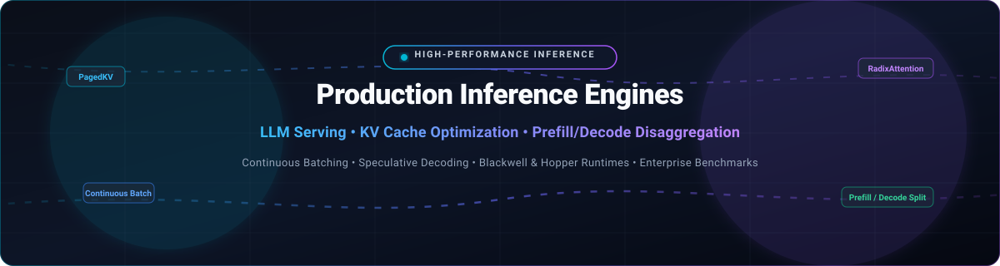

# ⚡ Awesome-High-Performance-Production-Inference-Engines 🚀

  

  
  
  
  
  

> 💡 **Curated directory of industry-leading SaaS platforms and open-source GitHub projects for high-performance LLM production inference engines, KV cache optimizations, disaggregated prefill/decode, continuous batching, and high-throughput GPU serving infrastructure.**

*📅 Last updated: October 2026*

---

## 🏛️ Overview & Architecture Highlights

Serving Large Language Models (LLMs) and multimodal foundation models in production requires specialized inference engines designed to maximize token throughput (tokens/second), minimize time-to-first-token (TTFT) and inter-token latency (ITL), and saturate accelerator utilization (NVIDIA Hopper/Blackwell, AMD Instinct, Apple Silicon, and modern server CPUs).

Key production architectural paradigms tracked in this repository:
- 🧠 **KV Cache Optimizations**: PagedAttention (vLLM), RadixAttention with variable-length prefix caching (SGLang), and FP8/FP4 quantized KV caching.
- 🔀 **Prefill/Decode Disaggregation**: Decoupling compute-heavy prompt prefilling from memory-bandwidth-bound autoregressive decoding across dedicated GPU clusters.
- ⚡ **Continuous / In-Flight Batching**: Dynamically injecting newly arriving requests at iteration boundaries to eliminate idle execution slots.
- 🎯 **Speculative Decoding & Jump-Forward Generation**: Draft-target speculative execution (EAGLE-3, Medusa) and jump-forward grammar scheduling for structured JSON/regex/tool-call generation.
- 💻 **Heterogeneous Hardware Backends**: Bare-metal CUDA/Triton kernels, ROCm HIP, Metal Performance Shaders (MPS), AVX-512/AMX CPU engines, and TPU runtime support.

---

## 📑 Table of Contents

- [📊 Sector Overview & Market Dynamics](#-sector-overview--market-dynamics)
- [☁️ SaaS & Hosted Inference Platforms](#️-saas--hosted-inference-platforms)
- [🔓 Open-Source GitHub Projects](#-open-source-github-projects)
- [🧭 Framework Selection Guide](#-framework-selection-guide)
- [🤝 How to Contribute](#-how-to-contribute)
- [⭐ Star History](#-star-history)
- [💖 Support](#-support)
- [📜 Disclaimer](#-disclaimer)

---

## 📊 Sector Overview & Market Dynamics

The global AI inference market has reached an estimated valuation of **$100B–$125B**, driven by the enterprise shift from initial foundation model pre-training to full-scale continuous inference execution. The sector is **moderately fragmented** rather than a winner-take-all monopoly: while hyperscalers and primary silicon vendors dominate foundational hardware and core runtimes, specialized inference providers, orchestration layers, and open-source engines aggressively compete and differentiate on latency, memory bandwidth, prefix cache hit rates, cost-per-token, and data sovereignty.

---

## ☁️ SaaS & Hosted Inference Platforms

The table below benchmarks enterprise SaaS and hosted managed platforms for production LLM serving. Sorted descending by company valuation / market capitalization.

| Platform | 🏢 Company Valuation / Market Cap | 💰 Pricing (Starting Tiers) | 🎁 Free Tier Limits / Free Trial | 🛠️ Key Capabilities & Architecture |
| :--- | :--- | :--- | :--- | :--- |
| **[NVIDIA Dynamo / NIM](https://developer.nvidia.com/dynamo)** | ~$5.3T–$5.6T (Market Cap) | $1.00/GPU-hr (Cloud Marketplace) or $4,500/GPU/yr (NVIDIA AI Enterprise license) | Free evaluation tier via NVIDIA Developer Program with 1,000 free inference API credits; max rate limit capped at 40 RPM | Datacenter-scale distributed inference serving framework. Disaggregated prefill/decode, KV cache offloading, and dynamic GPU scheduling optimized for Blackwell and Hopper architectures. |
| **[Fireworks AI](https://fireworks.ai/)** | ~$17.5B–$18.0B (Valuation) | $0.20 per 1M tokens (Llama 3.1 8B text inference) / $0.0002 per step (image generation) | $1.00 free one-time signup developer credit (approx. 1M–5M tokens on lightweight models, no expiry); up to $50 credit via partner developer programs (valid 90 days) | Ultra-low latency inference platform with function calling, structured generation, custom LoRA deployment, and hand-tuned CUDA/Triton kernels. |
| **[Modal Labs](https://modal.com/)** | ~$15.75B (Valuation) | Starter plan pay-as-you-go: $0.000028/sec ($0.10/hr) CPU compute; $0.000553/sec ($1.99/hr) NVIDIA A100-40GB; Team plan base $250/mo | Starter Tier includes $30.00/month recurring free compute credits (resets monthly; credit card required for verification; standard concurrency caps) | Serverless containerized GPU infrastructure with sub-second cold starts, dynamic scale-to-zero, and multi-GPU cluster orchestration up to 50,000+ concurrent workers. |
| **[Baseten](https://baseten.co/)** | ~$13.0B (Valuation) | Pay-as-you-go: $0.20 per 1M tokens (Model API 8B tier); dedicated GPU instances from $0.60/hr (A10G) to $4.26/hr (H100) | $30.00 one-time initial workspace signup credit for testing serverless Model APIs and dedicated GPU instances (no permanent free compute tier) | Production ML deployment and inference orchestration powered by open-source Truss. Features autoscaling, zero-downtime rollouts, and multi-cloud GPU routing. |
| **[Together AI](https://www.together.ai/)** | ~$8.3B (Valuation) | Serverless API from $0.18 per 1M input tokens / $0.18 per 1M output tokens (Llama 3.1 8B); minimum initial account deposit of $15.00 | No permanent free tier or automatic trial credits; access requires a minimum $15.00 initial prepaid balance (eligible early-stage startups can apply for up to $50,000 in startup credits) | Full-stack generative AI platform with managed inference, fine-tuning, and dedicated GPU clusters across 100+ open-source models with sub-second response times. |

---

## 🔓 Open-Source GitHub Projects

The following active open-source projects represent the state-of-the-art in self-hosted LLM serving, local edge inference, KV cache optimization, and embedding pipelines. Sorted descending by GitHub star count.

| Project | ⭐ Stars | 🚀 Primary Architecture & Key Features | 📜 License |
| :--- | :--- | :--- | :--- |
| **[Ollama](https://github.com/ollama/ollama)** |  | **The simplest out-of-the-box local model serving daemon.** Bundles model management, Modelfile packaging, OpenAI-compatible REST endpoints, and automated multi-GPU/CPU offloading across macOS, Linux, and Windows. | MIT |
| **[llama.cpp](https://github.com/ggml-org/llama.cpp)** |  | **Universal edge and desktop inference with zero external dependencies.** Pure C/C++ supporting GGUF quantization (Q4_K_M, IQ4_XS, IQ3_S), AVX2/AVX-512, CUDA, ROCm, Metal MPS, Vulkan, and OpenCL across edge, mobile, and server hardware. | MIT |
| **[vLLM](https://github.com/vllm-project/vllm)** |  | **The production standard for high-throughput concurrent LLM serving.** Invented **PagedAttention** for near-zero memory waste in KV cache. Features continuous batching, prefill/decode disaggregation, chunked prefill, speculative decoding (EAGLE-3), Sleep Mode memory release, and multi-LoRA batching. | Apache-2.0 |
| **[SGLang](https://github.com/sgl-project/sglang)** |  | **Fastest engine for multi-turn chat, autonomous agents, and structured generation.** Introduces **RadixAttention** (hierarchical prefix caching reducing prefill tokens by up to 71% on RAG workloads) and scheduler-level **jump-forward decoding** (up to 7x faster on JSON/regex grammar constraints). Adopted across xAI, Cursor, and major public clouds. | Apache-2.0 |
| **[TensorRT-LLM](https://github.com/NVIDIA/TensorRT-LLM)** |  | **Maximum single-replica throughput on NVIDIA GPUs.** Hand-tuned kernels for Hopper (TMA+WGMMA) and Blackwell (tcgen05, native FP4/FP8), FlashAttention-4, in-flight batching, and KV cache quantization. Ideal for static, peak-throughput enterprise deployments. | Apache-2.0 |
| **[Triton Inference Server](https://github.com/triton-inference-server/server)** |  | **Enterprise multi-model inference serving system.** Serves LLMs, vision, audio, and tabular models simultaneously with dynamic batching, concurrent model execution, model ensembling, and integration with TensorRT, ONNX, and vLLM backends. | BSD-3-Clause |
| **[Text Generation Inference (TGI)](https://github.com/huggingface/text-generation-inference)** |  | **Hugging Face production LLM serving stack.** Features Tensor Parallelism, FlashAttention-2/3, Paged Attention, token streaming via SSE, watermarking, dynamic batching, and native safetensors weights loading. | Apache-2.0 |
| **[Xinference](https://github.com/xorbitsai/inference)** |  | **Unified distributed inference framework for LLMs, speech, and multimodal models.** Supports seamless orchestration across vLLM, llama.cpp, and SGLang backends with cluster management and OpenAI-compatible APIs. | Apache-2.0 |
| **[vLLM-Omni](https://github.com/vllm-project/vllm-omni)** |  | **Omni-modality serving extension for vLLM.** Expands high-throughput batching to non-autoregressive multimodal architectures (Diffusion Transformers, Speech-to-Speech, Vision-Language-Action models, and robot policies). | Apache-2.0 |
| **[Text Embeddings Inference (TEI)](https://github.com/huggingface/text-embeddings-inference)** |  | **High-performance embedding and reranking engine.** Blazing-fast Rust-based server implementing FlashAttention and token-level dynamic batching for Sentence Transformers, dense/sparse embeddings, and cross-encoders. | Apache-2.0 |
| **[ExLlamaV2](https://github.com/turboderp/exllamav2)** |  | **Ultra-fast local inference library for consumer and workstation GPUs.** Features custom EXL2 quantization (variable bitrate per weight tensor) delivering exceptional inference speeds and low VRAM footprints. | MIT |
| **[SIE (Superlinked Inference Engine)](https://github.com/superlinked/sie)** |  | **Unified inference engine for embeddings, reranking, and extraction.** Supports 85+ models across `encode`, `score` (cross-encoder), and `extract` (zero-shot NER via GLiNER) with KEDA scale-to-zero, LRU model eviction, and Grafana monitoring. | Apache-2.0 |
| **[TokenSpeed](https://github.com/lightseekorg/tokenspeed)** |  | **Speed-of-light inference engine designed for agentic workloads.** Separates control plane (C++ finite-state machine) from execution plane (Python), enforcing type-safe KV resource reuse at compile time with Pareto-competitive Blackwell throughput. | Apache-2.0 |
| **[AMD PACE](https://github.com/amd/AMD-PACE)** |  | **High-performance agentic orchestrator and inference server for AMD EPYC CPUs.** Integrates LangGraph as native orchestration layer with deterministic execution replay and hybrid CPU-orchestration / GPU-inference offloading. | MIT |

---

### 📦 Additional Specialized Open-Source Tools & Libraries

- 🍏 **[Rapid-MLX](https://pypi.org/project/rapid-mlx/)** — Accessible Apple Silicon native local inference engine built on Apple MLX with one-command Claude Code CLI integration and OpenAI-compatible server.
- ⚙️ **[tei-serving](https://pypi.org/project/tei-serving/)** — Config-driven launcher for Hugging Face Text Embeddings Inference (TEI) with YAML validation and dynamic batching parameters.
- 🎙️ **[inferna](https://pypi.org/project/inferna/)** — Multimodal inference wrapper integrating llama.cpp, whisper.cpp, and stable-diffusion.cpp via unified Python API and CLI.
- 🧰 **[gks](https://pypi.org/project/gks/)** — Lightweight unified toolkit for GGUF model execution, local OpenAI-compatible endpoint hosting, and metadata inspection.
- 🔧 **[gguf-cpp](https://pypi.org/project/gguf-cpp/)** — C++ GGUF model toolkit featuring server runtime, diffusion pipelines, and custom quantization scripts.
- 🔊 **[rapidspeech-cuda](https://pypi.org/project/rapidspeech-cuda/)** — High-throughput CUDA-accelerated ASR and TTS serving with GGUF quantization and Voice Activity Detection (VAD).
- 👁️ **[OpenLLaVA](https://huggingface.co/Openllava)** — Framework for injecting vision capabilities into Hugging Face LLMs with unified serving workflows.

---

## 🧭 Framework Selection Guide

| Workload Characteristic | 🎯 Recommended Engine / Framework | 💡 Key Decision Factor |
| :--- | :--- | :--- |
| **High-Concurrency Multi-User APIs** | **vLLM** | Mature continuous batching, chunked prefill, broad ecosystem integration, multi-LoRA support. |
| **Multi-Turn Chat, Agents & RAG** | **SGLang** | RadixAttention delivers up to 71% prefill token savings; jump-forward grammar decoding for structured JSON/tools. |
| **Max Peak Throughput (Stable Model, NVIDIA)** | **TensorRT-LLM** | 1.5–2x faster single-replica throughput via hand-tuned Blackwell/Hopper kernels and FP4/FP8 optimizations. |
| **Enterprise Heterogeneous Multi-Model Serving** | **Triton Inference Server** | Unified concurrent serving across LLMs, vision, audio, and classical ML backends with dynamic batching. |
| **Edge, Local Desktop, & Consumer Hardware** | **llama.cpp / Ollama** | Universal GGUF format, zero external dependencies, CPU/Metal/CUDA portability. |
| **Dedicated Embeddings & Semantic Search** | **TEI / SIE** | Token-level dynamic batching, cross-encoder reranking, and zero-shot NER extraction. |

---

## 🤝 How to Contribute

Contributions are warmly welcome! To propose additions or updates:

1. 🍴 Fork this repository.
2. 🌿 Create a feature branch (`git checkout -b feature/add-engine`).
3. 📝 Add your entry following the established table schema and factual benchmarking style.
4. 🔍 Verify all links, images, and badges render properly.
5. 🚀 Submit a descriptive Pull Request.

---

##  Star History

---

## 💖 Support

Thank you for exploring and using **Awesome-High-Performance-Production-Inference-Engines**!

If you find this curated directory useful for your research, team, or production infrastructure:
- ⭐ **Star this repository** on GitHub to help others discover it.
- 🍴 **Fork and contribute** updates or new state-of-the-art inference engines.
- 📢 **Share** with colleagues and AI engineering communities.
- ☕ **Sponsor / Buy me a coffee**: You can support ongoing maintenance via the [GitHub Sponsors Dashboard](https://github.com/sponsors/ishandutta2007).

---

## 📜 Disclaimer

- 📌 This repository is a community-curated directory intended for research, architectural comparison, and benchmarking.
- ⚠️ Model performance, memory usage, and throughput metrics vary depending on hardware architectures (GPU/CPU/NPU), model parameter scale, quantization bitwidths, and context length distribution. Benchmark against your specific production workload before deploying.
- 🏷️ All trademarks and brand names belong to their respective holders.
